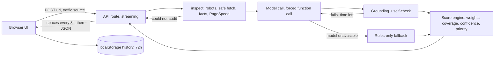

# CRO Score Agent: design document

What the app does, how it works, and why it was built this way. Rebuild steps are in `BUILD_INSTRUCTIONS.md`; this document explains the reasoning.

Live app: https://cro-test-build.vercel.app. Source: https://github.com/istion/cro-test-build.

---

## 1. Summary

A user enters one page URL (and optionally the ad or email that sends traffic there). The app fetches the page, measures it, asks a language model to judge the parts that need judgement, checks every claim the model makes against the fetched page, and returns a **0 to 100 conversion-readiness score** with the arithmetic shown, evidence-backed findings, and a prioritised plan.

The central design choice: **the model never produces the score.** It produces pillar judgements and findings. Code verifies them and does all the maths. That is what separates this from asking a chatbot "rate my page".

## 2. Goals and non-goals

**Goals**

- A score a client can trust enough to prioritise work: reproducible arithmetic, visible logic, cited evidence.
- Page-specific advice, never generic tips.
- Honest about what was and was not checked.
- Hard to manipulate (by text on the page) and safe to run against arbitrary URLs.
- Always returns something useful, even when the model is down.
- Simple to host: one Next.js app on Vercel, no database.

**Non-goals**

- Rendering pages in a browser (tap targets, contrast, screenshots, JavaScript-only pages).
- Visitor behaviour, analytics or conversion data (a public page cannot show it).
- Predicting revenue or promising uplift.
- Accounts, logins, or server-side storage.
- Running experiments. The score prioritises ideas; only an A/B test proves them.

## 3. System overview

| Layer | Responsibility | Trusted? |
|---|---|---|
| `lib/guard.ts` | Fetch only public web pages, safely | Code |
| `lib/inspect.ts` | Measure facts: headings, CTAs, forms, cues, speed | Code |
| `lib/injection.ts` | Flag instruction-like text on the page | Code |
| `lib/llm.ts`, `lib/audit.ts` | Ask the model for judgements | **Untrusted output** |
| `groundLedger`, `selfCheck` | Verify the model against the fetched page | Code |
| `lib/scoring.ts` | Weighted score, coverage, confidence, priority | Code |
| `lib/rules.ts` | Fallback audit with no model | Code |
| `app/page.tsx` | UI, history, PDF | Client |

## 4. How an audit runs

1. **Fetch gate.** Check `robots.txt`, then fetch with the SSRF guard. Stop with "Could not audit" for: robots disallow, HTTP 401/403/4xx/5xx, non-HTML, CAPTCHA text, under 300 characters of static text (probably JavaScript-rendered), or a login wall. No score is given in those cases.
2. **Measure.** Cheerio extracts facts: title, meta description, H1 and headings, CTA candidates, forms (field counts, pre-ticked boxes, unlabelled fields), image alt gaps, structured data, trust cues (price, reviews, returns, shipping, contact, secure, subscription, stock), tags, A/B tooling, consent banners. PageSpeed Insights adds Core Web Vitals if a key is set.
3. **Scan for manipulation.** The injection scanner checks the visible text, meta tags, image alts, hidden elements and HTML comments. Hits become integrity flags shown to the user.
4. **Ask the model.** One call with a forced function (`submit_audit`). The page text goes inside `<page_content trust="untrusted">` tags. The model returns a ledger (quotes), pillar scores for pillars 1 to 6, findings, recommendations and limitations.
5. **Verify.** Each ledger quote must be a substring of the fetched text or facts JSON. If not, it is downgraded to a hypothesis. The self-check then rejects: scores under 100 with no real evidence, severity-3 findings without verified evidence, recommendations that promise a numeric uplift or look like dark patterns, and level-3 changes labelled "small". If something fails and at least 60 seconds remain, the model gets one correction call; otherwise the failing parts are removed. If the correction call itself fails, the first answer is kept.
6. **Score.** Code snaps pillar scores to steps of 5, scores pillar 7 from Core Web Vitals bands, forces pillar 8 to "needs data", then applies the formula below. Recommendations are ranked by the priority formula.
7. **Stream.** The reply starts immediately and sends a space every 8 seconds until the JSON result is ready.

## 5. The score

`score = sum(weight × pillar score) ÷ sum(weight of pillars that were scored)`

- **Eight pillars:** value proposition, message match, CTA and friction, offer and pricing, trust, hierarchy/mobile/accessibility, speed, behaviour data. Each has written anchors at 0, 50 and 100.
- **Weights depend on page type** (landing, homepage, product, collection, checkout, lead). For example CTA and friction is 16 on a product page and 32 on checkout; message match is 0 on checkout.
- **Unscored pillars drop out of both sides.** Missing data cannot drag the score down. It lowers **coverage** and **confidence** instead.
- **Confidence is separate.** Public audits are capped at Medium. Each of these lowers it one level: coverage under 60, unclear page type, A/B tooling present, consent banner present, URL redirected, and (always) only static HTML inspected. A failed tool on a heavily weighted pillar forces Low.
- **Bands:** 90+ Strong foundations, 75 to 89 Good with opportunities, 60 to 74 Moderate, 40 to 59 Weak, below 40 Critical gaps.
- **Priority** of a recommendation = `(impact × evidence × severity) ÷ (effort + brand risk)`. Measured evidence beats observed beats hypothesis. Impact is low, medium or high with a reason; no percentage uplift is ever stated.
- **Approval levels:** 1 copy and labels, 2 layout and proof blocks, 3 brand, pricing, offer terms and claims. Level 3 is shown only as a strategic hypothesis.

## 6. Key decisions

Each entry: what we chose, why, and what it costs.

**D1. Code owns the score; the model only judges.**
Chose a deterministic formula over letting the model output a number. *Why:* model scores drift between runs and can be argued into a higher number; arithmetic can be shown and checked. *Cost:* the model's pillar judgements still vary between runs, so the score is not perfectly repeatable (see section 9).

**D2. Evidence or no deduction.**
Every ledger entry carries a quote that code looks up in the fetched page. Unverifiable entries become hypotheses and cannot lower the score. *Why:* this is what makes findings page-specific and stops invented observations. *Cost:* occasionally a true observation is downgraded because the model paraphrased the quote.

**D3. Missing data lowers confidence, never the score.**
*Why:* scoring "unknown" as zero punishes pages for what a public audit cannot see. *Cost:* a page can score well with low coverage; the confidence chip and coverage figure are the safeguard and must stay prominent.

**D4. Public audit only: pillar 8 (behaviour) is never scored; pillar 7 is scored by code.**
*Why:* a public page cannot show visitor behaviour, and speed has objective thresholds. *Cost:* without a PageSpeed key pillar 7 is "could not test", which also lowers confidence.

**D5. Shopify is not an input.**
An early version read a store's public `/products/<handle>.json` and showed a Shopify badge. The requirement's note about Shopify was about Shopify also offering analytics, not about using it as data. It was removed entirely so nothing in the app depends on a platform.

**D6. Forced function calling with a strict schema, one call plus at most one correction.**
*Why:* structured output is far more reliable than parsing prose, and a bounded loop keeps cost and latency predictable. *Cost:* it is a fixed pipeline, not an open-ended agent that browses or retries freely. The UI says so honestly.

**D7. Prompt-injection defence in layers.**
Untrusted tags and an explicit trust-boundary section in the prompt; a regex scanner over every attacker-controlled surface; flags shown to the user; and, above all, code owns the score so the worst a hidden instruction can do is skew a pillar judgement that the evidence rule then constrains.

**D8. Safe fetching.**
DNS resolution with a private-range block, manual redirects re-validated per hop, port and credential restrictions, size and time caps, robots.txt honoured (wildcards and longest-match rule). *Why:* the server fetches user-supplied URLs, which is a textbook SSRF surface. An early robots parser blocked whole sites on wildcard rules and was rewritten.

**D9. Provider-agnostic LLM layer, Gemini by default.**
Anthropic was the first choice, but the user's organisation blocked creating an Anthropic account, so the app also speaks to Gemini through its REST API (no SDK). Anthropic is used automatically if its key is set. *Cost:* the Gemini path needs schema conversion (integer enums are rejected) and its own error handling.

**D10. Model chain: `gemini-3.1-pro-preview` first, `gemini-3.6-flash` as fallback, each tried twice.**
Decided from measurement, not preference:

| Model | Result in testing |
|---|---|
| `gemini-3.6-flash`, `3.5-flash` | About 30 s, good quality, but the free tier allows about 20 requests per day per project; frequent 503s |
| `gemini-3.7-flash`, `3.8-flash` | Hung for one to three minutes; removed from the chain |
| `gemini-3.1-flash-lite` | Fast but unreliable (a score of 100 from two pillars); not used |
| `gemini-2.5-pro`, `2.5-flash` | 404 for this key |
| `gemini-3.1-pro-preview`, `gemini-pro-latest` | 30 to 60 s, best quality; needs billing on the Google project |

Billing was enabled by the owner, which made Pro usable. The chain cycles twice because 503s ("high demand") usually clear within seconds.

**D11. A rules-only fallback instead of an error.**
When the model is busy, out of quota, slow or unreachable, the app returns fixed checks on the markup (headline present, CTA wording, form size, price and shipping mentions, trust cues, viewport tag, alt text), clearly labelled "Rules-only result", low confidence, with every finding still quoting the facts JSON. *Why:* the owner needed at least one working result at all times. *Cost:* it cannot judge copy, offer strength or message match, so findings are generic. It is never saved to history, so it cannot block a proper run, and the UI says to re-run later.

**D12. Stream a heartbeat from the API.**
Audits take 60 to 170 seconds. A silent HTTP request that long is dropped by many networks, and the owner's network did exactly that: the page said "Could not reach the server" while the server logs showed successful audits. The route now replies at once and sends a space every 8 seconds (JSON ignores leading whitespace), then the result; errors travel in the body. *Cost:* the HTTP status is always 200 once streaming starts, so the client checks `error` in the body.

**D13. One shared time budget, measured from the request start.**
Page inspection (up to about 40 seconds) used to sit outside the model's budget, so a slow page plus a correction call could pass Vercel's limit and kill the request. The deadline now starts when the audit starts (140 seconds, route limit 180), the first model gets about 65% of what is left, and the correction call is skipped when under 60 seconds remain. The PageSpeed call is capped at 20 seconds.

**D14. History lives in the browser, not on a server.**
Reports from the last 72 hours are kept in `localStorage` (up to 12). Submitting the same page again shows the saved report with no model call; running again requires choosing a reason. Page identity ignores `www`, hashes, tracking parameters and trailing slashes. *Why:* it needs no database or accounts, costs nothing, and meets the goal of avoiding repeat model runs. *Cost:* history is per browser and per device; it is not shared between people and disappears if the user clears site data.

**D15. PDF through the browser's print dialog.**
A print stylesheet reproduces the report (light palette forced, ring and cards kept, form and explainer hidden, no page breaks inside items) and the user chooses "Save as PDF". *Why:* identical design to the screen with no server-side browser (heavy on serverless). *Cost:* it is a print dialog, not a one-click file download.

**D16. Design.**
Warm editorial look inspired by a reference app the owner liked: dark gradient hero with a serif headline, a pill-shaped URL input, an SVG score ring colour-coded by score, pillar cards with bars, and severity-striped findings. Fonts are Inter and Fraunces. Dark mode is supported; the layout works at phone width. The "logic behind the score" table stays visible because explaining the score is a requirement.

**D17. Transparency section at the bottom of the home page.**
The six points in the owner's handwritten brief (agent, guardrails, why it is not generic, logic behind the score, limitations) are answered in a "How this agent works" section, including a comparison with a generic CRO prompt.

## 7. Guardrails summary

| Risk | Control |
|---|---|
| Model invents observations | Quote must exist in the fetched page, else hypothesis |
| Model inflates the score | Code computes it; scores must be multiples of 5; evidence needed for anything under 100 |
| Hidden instructions on the page | Untrusted tags, scanner over every surface, flags shown, code owns the score |
| Promised uplift or fake numbers | Self-check rejects them; impact is low/medium/high with a reason |
| Dark patterns | Prompt rule plus self-check on recommendation text |
| Brand damage | Approval levels; level 3 only as a hypothesis; "keep unchanged" on every recommendation |
| Regulated claims | Regex flags them for human review; the agent does not rule on legality |
| SSRF and abuse | Public-IP check, redirect re-validation, port/credential limits, caps, robots.txt, per-IP rate limit |
| Silent failure | "Could not audit" with a reason, or a labelled rules-only result |
| Leaking secrets | Keys only in environment variables; `.env*` and `.vercel` ignored by git |

## 8. Frontend behaviour

- One page. Form in the hero; progress card with timed steps while waiting; report below.
- Report: score ring and chips, eight pillar cards, the logic table, findings with their verified quotes, the plan grouped by effort bucket, integrity flags, human-review flags, limitations, and a collapsed raw-evidence block.
- History: "Recent audits" list, saved-report notice with the reason prompt, "Clear history".
- Export: "Download as PDF".
- The explainer, history and raw evidence do not appear in the PDF.

## 9. Known limits and open questions

- **Score variance.** The arithmetic is fixed, but the model's pillar judgements vary between runs. The same collection page scored 100 in one run and 92 in another, and Pro scored a sold-out product page around 87 to 90 where Flash scored it 60 to 67. Not yet investigated: whether Pro is simply more lenient, and whether averaging several runs, lowering temperature, or a calibration set of pages would help.
- **No rendering.** Single-page apps and JavaScript-only content return "Could not audit"; tap targets and contrast are not measured. A headless-browser mode is the largest missing capability.
- **Weights are proposals.** They have not been validated against expert audits or A/B results.
- **Message match** needs the ad or email text to be fully scored.
- **Rate limit is in memory** per serverless instance: it deters casual abuse, not a determined attacker.
- **Audit time** is about one to two minutes (inspection about 30 to 40 seconds, then Pro). Running PageSpeed in parallel with the model call would save about 20 seconds.
- **Some sites block server-side fetches** (503 or 403); the app reports it rather than guessing.
- **History is per browser,** not shared.
- **Hobby-plan logs** keep little history, which limits after-the-fact debugging.

## 10. How the design evolved

1. Started from a written specification for an evidence-led CRO score agent; a Python reference version (deterministic scorer, ingest, injection scan, 30 tests) was built first.
2. Rebuilt as a Next.js app on Vercel with the same rubric and scoring logic ported to TypeScript.
3. Anthropic access was unavailable, so Gemini support was added, then a model chain after measuring quota, latency and quality.
4. Failures in real use drove changes: Vercel's output-directory error (pinned the framework), 404s from a bad deployment, free-tier quota exhaustion and 503s (fallback chain, then billing), request timeouts (shared time budget), "Could not reach the server" (streaming heartbeat), and the wish for at least one working call (rules-only fallback).
5. Product additions: redesigned interface, transparency section, 72-hour history with a re-run reason, and PDF export.
6. Shopify was removed as an input after clarifying what the original note meant.
